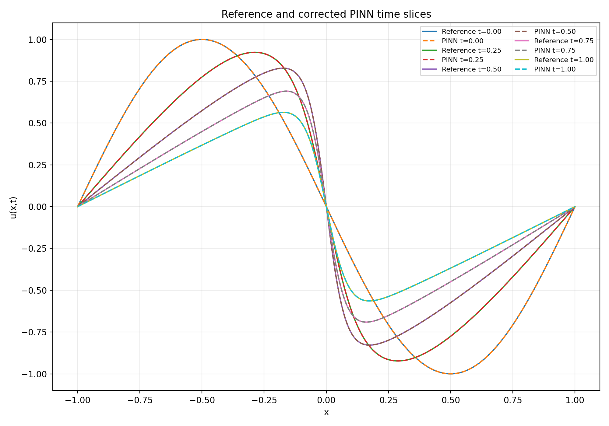
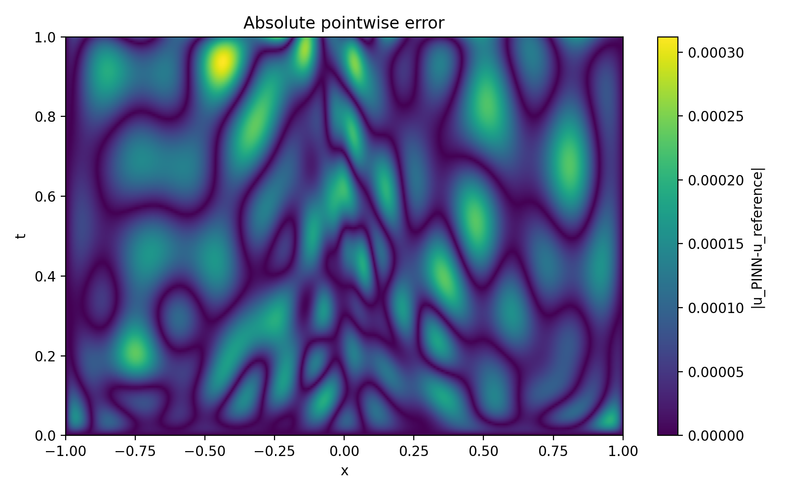

# Explainable Quantum-Assisted PINNs for CFD

**WISER/BQP Quantum+AI Challenge 2026 project repository**

This repository develops controlled classical and hybrid quantum-classical Physics-Informed Neural Network (PINN/QAPINN) benchmarks for partial differential equations and reduced computational-fluid-dynamics problems. The central goal is not merely to compare final errors, but to explain **when, why, and how a variational quantum circuit changes physics-informed learning**.

The project begins with the one-dimensional viscous Burgers equation, then progresses to the heat equation, quantum-layer ablations, explainability studies, and a reduced projectile-aerodynamics problem.

## Current status

| Section | Experiment | Status |
|---|---|---|
| 01 | Hard-constrained classical PINN for smooth Burgers equation | **Validated for seed 0** |
| 02 | Parameter-matched smaller classical PINN | Complete |
| 03 | Classical Fourier-feature PINN | Complete |
| 04 | 3-, 4-, and 5-qubit QAPINNs | Complete |
| 05 | Fourier, gradient, kernel, loss-landscape, and entanglement analysis | Complete |
| 06 | Heat-equation benchmark | Complete |
| 07 | Reduced projectile CFD benchmark | Complete |
| 08 | Technical report, slides, and final reproducibility package | Complete |

## Validated classical result

For

\[
\nu=\frac{0.1}{\pi},
\]

with seed 0, the hard-constrained classical PINN produced:

| Metric | Value |
|---|---:|
| Relative \(L_2\) error | \(1.6565\times10^{-4}\) |
| Mean absolute error | \(7.3563\times10^{-5}\) |
| Maximum absolute error | \(3.1189\times10^{-4}\) |
| Independent PDE residual RMS | \(2.1240\times10^{-3}\) |
| Trainable parameters | 16,897 |
| Initial-condition loss | 0 |
| Boundary-condition loss | \(1.50\times10^{-32}\) |





## Governing equation

The one-dimensional viscous Burgers equation is

\[
\frac{\partial u}{\partial t}
+u\frac{\partial u}{\partial x}
=\nu\frac{\partial^2u}{\partial x^2},
\qquad x\in[-1,1],\quad t\in[0,1],
\]

with

\[
u(x,0)=-\sin(\pi x),
\qquad
u(-1,t)=u(1,t)=0.
\]

The corrected classical PINN uses the hard-constrained output

\[
\hat u_\theta(x,t)
=-\sin(\pi x)+t(1-x^2)N_\theta(x,t),
\]

so the initial and boundary conditions are satisfied exactly for every set of network parameters. The optimizer minimizes only the interior physics residual

\[
R_\theta
=\hat u_t+\hat u_\theta\hat u_x-\nu\hat u_{xx}.
\]

## Repository sections

```text
wiser-bqp-qapinn-cfd/
├── README.md
├── requirements.txt
├── requirements-quantum.txt
├── environment.yml
├── pyproject.toml
├── configs/
├── data/
│   ├── reference/
│   └── collocation/
├── docs/
├── experiments/
│   ├── 01_classical_pinn/
│   ├── 02_parameter_matched_pinn/
│   ├── 03_fourier_feature_pinn/
│   ├── 04_qapinn/
│   ├── 05_xai/
│   ├── 06_heat_equation/
│   └── 07_projectile_cfd/
├── notebooks/
├── report/
├── results/
├── scripts/
├── slides/
├── src/wiser_qapinn/
└── tests/
```

The numbered experiment folders preserve a clear research sequence, while reusable implementation code remains in `src/wiser_qapinn/`.

## Quick start

### 1. Clone the repository

```bash
git clone https://github.com/YOUR_USERNAME/wiser-bqp-qapinn-cfd.git
cd wiser-bqp-qapinn-cfd
```

### 2. Create an environment

#### Linux/macOS

```bash
python -m venv .venv
source .venv/bin/activate
python -m pip install --upgrade pip
pip install -e .
```

#### Windows PowerShell

```powershell
python -m venv .venv
.venv\Scripts\Activate.ps1
python -m pip install --upgrade pip
pip install -e .
```

For future quantum experiments:

```bash
pip install -e ".[quantum]"
```

### 3. Run the smoke test

```bash
python scripts/run_burgers_cpinn.py \
  --profile smoke \
  --seed 0 \
  --output-root outputs
```

### 4. Run the validated smooth baseline

```bash
python scripts/run_burgers_cpinn.py \
  --profile baseline \
  --seed 0 \
  --output-root outputs
```

### 5. Repeat the baseline across seeds

```bash
python scripts/run_burgers_cpinn.py --profile baseline --seed 1 --output-root outputs
python scripts/run_burgers_cpinn.py --profile baseline --seed 2 --output-root outputs
```

### 6. Run the harder low-viscosity case

Run this only after the smooth baseline is reproducible:

```bash
python scripts/run_burgers_cpinn.py \
  --profile main \
  --seed 0 \
  --output-root outputs
```

## Colab or Kaggle

Install the repository in an active notebook session:

```python
!git clone https://github.com/YOUR_USERNAME/wiser-bqp-qapinn-cfd.git
%cd wiser-bqp-qapinn-cfd
!pip install -q -e .
```

Then run:

```python
!python scripts/run_burgers_cpinn.py \
    --profile smoke \
    --seed 0 \
    --output-root /content/wiser_outputs
```

For Kaggle, use a writable path under `/kaggle/working/` instead of `/content/`.

## Reproducibility outputs

Every run saves:

- exact configuration and environment metadata;
- reference solution and collocation points;
- Adam checkpoints and the final trained model;
- training history in CSV format;
- metrics in JSON and CSV formats;
- reference, prediction, error, time-slice, loss, and gradient figures;
- a complete reproducibility ZIP archive.

See [docs/REPRODUCIBILITY.md](docs/REPRODUCIBILITY.md) for the complete procedure.

## Evaluation principles

All classical and quantum models should use the same:

- governing PDE and physical domain;
- initial and boundary conditions;
- collocation points;
- random seeds;
- numerical precision where practical;
- optimizer budget or clearly documented compute budget;
- evaluation grid and error definitions.

The final comparison will report accuracy, PDE residual, runtime, parameter count, memory, generalization, and explainability metrics rather than relying on final loss alone.

## Data policy

Generated arrays, model checkpoints, CFD meshes, and large ZIP archives are intentionally excluded from ordinary Git tracking. Curated figures, metric tables, configuration files, and small reproducibility summaries are kept in the repository. Large research artefacts should be attached to a GitHub Release, stored with Git LFS, or deposited in an archival data repository.

## Team and tool-use documentation

Before final submission, complete:

- [docs/TEAM_CONTRIBUTIONS.md](docs/TEAM_CONTRIBUTIONS.md)
- [docs/AI_USAGE.md](docs/AI_USAGE.md)
- [docs/PROJECT_ROADMAP.md](docs/PROJECT_ROADMAP.md)

## License

The software scaffold is provided under the MIT License. Review the copyright holder and licensing decision before making the final repository public.
